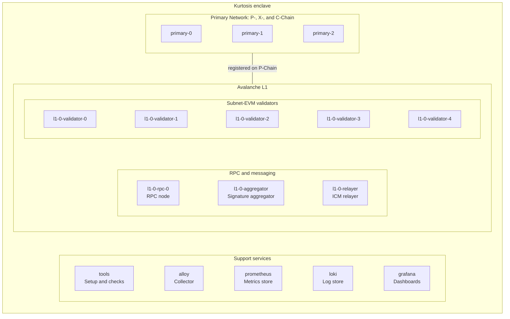

# kurtosis-avalanche

A [Kurtosis](https://docs.kurtosis.com/) package for local Avalanche devnets. It starts a **Primary Network** (P-, X-, and C-Chain) and one or more **Avalanche L1s**: Subnet-EVM blockchains with their own validators.

The package registers each L1 and its validators, supports Proof of Authority and Proof of Stake, and can add a token bridge, an observability stack (metrics, logs, and Grafana dashboards), and a Blockscout block explorer for the C-Chain and each L1.

> For local development and testing only. Funded accounts use public private keys. Never use these keys for real funds.

## Network architecture

The default Proof of Stake network ([examples/pos.yml](examples/pos.yml)) after setup. Each box is a container; temporary bootstrap validators are removed during setup.



## Requirements

- A running [Docker](https://docs.docker.com/get-docker/) runtime.
- The [Kurtosis CLI](https://docs.kurtosis.com/install) with its default Docker backend. CI uses version 1.18.2.
- Enough CPU, memory, and disk for your chosen topology. More validators and L1s require more resources.

The first run downloads images and builds the tools image from source. Default images are pinned by digest in [constants.star](src/config/constants.star):

| Component | Version |
| --- | --- |
| AvalancheGo, for the Primary Network | v1.15.0 |
| AvalancheGo with Subnet-EVM, for the L1 nodes | v1.15.0 |
| Signature aggregator | v0.6.0 |
| ICM relayer | v1.8.2 |
| Alloy | v1.22.0 |
| Grafana | v13.3.1 |
| Loki | v3.7.10 |
| Prometheus | v3.2.1 |
| Blockscout, with `explorer` | 9.0.2, frontend v2.3.5 |
| PostgreSQL, with `explorer` | 17.12 |

## Quick start

Clone this repository and run these commands from its directory:

```sh
kurtosis engine start
kurtosis run --enclave avalanche . --args-file examples/poa.yml
kurtosis enclave inspect avalanche
```

Choose an example or supply your own arguments file:

| File | Network |
| --- | --- |
| [examples/poa.yml](examples/poa.yml) | A minimal Proof of Authority network. |
| [examples/pos.yml](examples/pos.yml) | Proof of Stake with a token bridge and the observability stack. Shows every argument with its default. |

Use a fresh enclave name for each deployment. To remove the network:

```sh
kurtosis enclave rm -f avalanche
```

## Configure

Pass your YAML file with `--args-file`. Without one, the package uses the defaults shown in `examples/pos.yml`.

| Argument | Meaning |
| --- | --- |
| `primary_network.validator_count` | Number of Primary Network validators. |
| `l1.count` | Number of L1s. All L1s use the same configuration. |
| `l1.validator_management` | `poa`, `native-pos` (stake the L1's native token), or `erc20-pos` (stake an ERC-20 token). |
| `l1.validator_count`, `l1.rpc_count` | Validators and non-validating RPC nodes per L1. |
| `l1.chain_id` | EVM chain ID of the first L1; each subsequent L1 increments it by one. |
| `bridge` | Deploy a token bridge between the C-Chain and each L1. |
| `metrics` | Collect metrics: Alloy scrapes every node, relayer, and signature aggregator; Prometheus stores the samples. |
| `logs` | Collect logs: every node writes its log files to a shared volume; Alloy reads them and Loki stores the lines. |
| `dashboards` | Run Grafana with dashboards for the collected metrics and logs. |
| `rpc_port` | Fixed host port of the P-, X-, and C-Chain RPC; L1 `n` takes the port `rpc_port + 1 + n`. `0` picks random ports. |
| `explorer` | Run a Blockscout block explorer for the C-Chain and each L1. Off by default. |
| `explorer_port` | First host port of the explorers; each explorer takes two ports. |
| `images` | Override service images. |

The remaining arguments configure AvalancheGo and Subnet-EVM. The reference files explain each option and its default:

| Argument | Reference |
| --- | --- |
| `node_config`, `primary_network.node_config`, `l1.node_config` | [Node flags](docs/config/node.yml) |
| `l1.genesis` | [L1 genesis: gas fees, token supply, precompiles](docs/config/l1-genesis.yml) |
| `l1.subnet_config` | [L1 consensus and privacy](docs/config/l1-subnet.yml) |
| `l1.chain_config` | [L1 APIs, caches, and pruning](docs/config/l1-chain.yml) |
| `primary_network.c_chain_config` | [C-Chain settings](docs/config/c-chain.yml) |
| `primary_network.p_chain_config`, `primary_network.x_chain_config` | [P-Chain and X-Chain settings](docs/config/p-x-chain.yml) |

Unknown arguments and options managed by the package, such as ports and key paths, are rejected. See the [L1 lifecycle guide](docs/l1-lifecycle.md) for deployment details.

## Observe

With the default arguments, as in `examples/pos.yml`, the package starts Grafana before the network, so the dashboards show the deployment as it happens. `examples/poa.yml` turns the stack off; that takes `metrics`, `logs`, and `dashboards` all set to `false`. Open the address that this command prints; no login is needed:

```sh
kurtosis port print avalanche grafana http
```

Grafana opens on an overview of the devnet. Further dashboards cover one L1, the Primary Network, interchain messaging, and the logs of every node. See the [observability guide](docs/observability.md) for the dashboards, the labels, and the limits.

## Explore

With `explorer: true`, the package runs a [Blockscout](https://github.com/blockscout/blockscout) explorer for the C-Chain and for each L1. Open the C-Chain explorer at http://localhost:28000 and the explorer of L1 `n` at port `28000 + 2 × (n + 1)`. The deployment output lists every address under `explorers`. The P-Chain and the X-Chain are not EVM chains and have no explorer. See the [explorer guide](docs/explorer.md) for what the explorer shows, what it changes on the nodes, and its limits.

## Endpoints and accounts

With the default `rpc_port: 29650`, the first node of each chain answers on a fixed port of this machine. The deployment output lists these URLs under `host`, with each L1's blockchain ID.

| Chain | URL on this machine | EVM chain ID |
| --- | --- | --- |
| P-Chain | `http://127.0.0.1:29650/ext/bc/P` | Not applicable |
| X-Chain | `http://127.0.0.1:29650/ext/bc/X` | Not applicable |
| C-Chain | `http://127.0.0.1:29650/ext/bc/C/rpc` | `88888` |
| L1 `n` | `http://127.0.0.1:<29651 + n>/ext/bc/<blockchain-id>/rpc` | `77777 + n` by default |

A WebSocket URL replaces `http` with `ws` and `/rpc` with `/ws`. Every other node gets a random port: `kurtosis enclave inspect avalanche` lists them, and `kurtosis port print avalanche <service> rpc` prints one. Add the paths above to it.

The tools service describes each network in its own directory under `/opt/networks`: `primary-network/` for the P-, X-, and C-Chain, and `l1-0/`, `l1-1/`, … for the L1s. Each directory holds JSON files: the IDs and RPC URLs (`network.json`), the current validators, the genesis, and the development accounts that the package uses on that network, with their keys and roles (`accounts.json`). `primary-network/blockchains.json` is the answer of `platform.getBlockchains`; each L1 adds `subnet.json` from `platform.getSubnet`.

```sh
kurtosis service exec avalanche tools 'jq . /opt/networks/l1-0/network.json'
kurtosis files download avalanche network-description ./networks   # the same files
```

The shell script [`static_files/scripts/describe-networks.sh`](static_files/scripts/describe-networks.sh) writes them with `curl` and `jq`, which the tools service also offers for your own calls. It is mounted at `/fixtures/scripts/`; run it again to refresh the snapshot.

The Avalanche network ID is `88888`. The public development account, EWOQ, is funded on every chain:

| Account field | Value |
| --- | --- |
| Private key | `0x56289e99c94b6912bfc12adc093c9b51124f0dc54ac7a766b2bc5ccf558d8027` |
| C-Chain and L1 address | `0x8db97C7cEcE249c2b98bDC0226Cc4C2A57BF52FC` |
| P-Chain address | `P-custom18jma8ppw3nhx5r4ap8clazz0dps7rv5u9xde7p` |
| X-Chain address | `X-custom18jma8ppw3nhx5r4ap8clazz0dps7rv5u9xde7p` |
