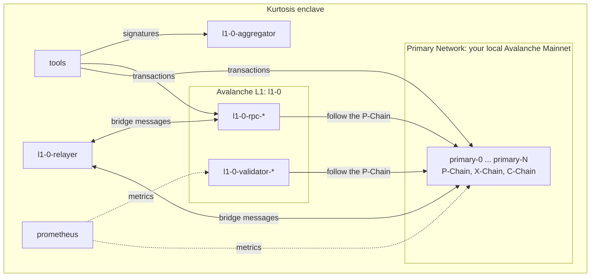

# kurtosis-avalanche

A devnet orchestration environment for Avalanche. This [Kurtosis](https://docs.kurtosis.com/) package starts a complete Avalanche network in containers on one machine, with one command.

The network has two parts:

- A **Primary Network** with its P-Chain, X-Chain, and C-Chain. It is your private stand-in for Avalanche Mainnet.
- One or more **Avalanche L1s**: Subnet-EVM blockchains with their own validators, registered on that Primary Network.

The package runs every step that makes an L1 active: the P-Chain transactions, the validator manager contracts, and the registration of each validator, with Proof of Authority or Proof of Stake. It can add a token bridge between the C-Chain and the L1, and metrics. Every run ends with tests that prove the network works.

> **For local development and testing only.** This is not a way to run a production network or to connect to Fuji or Mainnet. Every funded account uses a publicly known private key. Never use these keys for real funds.

## Requirements

| | |
| --- | --- |
| Operating system | Tested on Ubuntu 22.04 (x86_64). On macOS, [OrbStack](https://orbstack.dev/) is the recommended Docker runtime, because it manages the memory and CPU of the containers on demand. |
| [Docker](https://docs.docker.com/get-docker/) | Tested with Docker Engine 28.0. Kurtosis must use its Docker backend, which is the default. The Kubernetes backend is not tested. |
| [Kurtosis CLI](https://docs.kurtosis.com/install) | Tested with 1.18.2, the version that CI pins. |
| Resources | The Proof of Stake example runs 13 containers, and 16 during setup. In our test it used about 2 GB of memory at its peak. A machine with 4 CPUs, 8 GB of memory, and 10 GB of free disk has room to spare. The Proof of Authority example runs 6 containers. |
| Network access | The first run pulls the images and builds the tools image from source. This takes a few minutes. Later runs use the Docker cache. |
| For `scripts/check-devnet.sh` | `curl` and `jq`. |

The package pins every image by digest (`src/config/constants.star`):

| Component | Version |
| --- | --- |
| AvalancheGo, for the Primary Network | v1.15.0 |
| AvalancheGo with Subnet-EVM, for the L1 nodes | v1.15.0 |
| Signature aggregator | v0.6.0 |
| ICM relayer | v1.8.2 |
| Prometheus | v3.2.1 |

Every network upgrade through Helicon is active from the first block. Helicon is the latest upgrade of AvalancheGo v1.15.0, which schedules it on Mainnet for 22 September 2026.

## Quick start

Clone this repository and start the Kurtosis engine. Then run **one** of the two examples from the repository directory.

```sh
kurtosis engine start
```

Proof of Authority, the smallest network: 4 nodes, about 1 minute.

```sh
kurtosis run --enclave avalanche . --args-file examples/poa.yml
```

Proof of Stake: 5 staked validators, a bridge, and metrics. About 3 minutes.

```sh
kurtosis run --enclave avalanche . --args-file examples/pos.yml
```

The run is complete when Kurtosis prints `Starlark code successfully run` and the manifest of the network.

```sh
kurtosis enclave inspect avalanche        # List the services and their ports.
bash scripts/check-devnet.sh avalanche    # Check the network: see "Check the devnet".
kurtosis enclave rm -f avalanche          # Remove the network.
```

Use a new enclave for each run: remove the old one first, or choose another name. `bash scripts/run.sh [arguments-file]` picks a new name for you.

## What you get



| Service | Role |
| --- | --- |
| `primary-<n>` | Primary Network validator. Runs the P-Chain, X-Chain, and C-Chain. |
| `l1-<i>-validator-<n>` | Validator of L1 number `i`. |
| `l1-<i>-rpc-<n>` | RPC node of the L1. It does not validate. Send your transactions here. |
| `l1-<i>-aggregator` | Signature aggregator. Collects the validator signatures for cross-chain messages. |
| `l1-<i>-relayer` | ICM relayer. Delivers bridge messages. Only with `bridge: true`. |
| `prometheus` | Scrapes the metrics of every node. Only with `metrics: true`. |
| `tools` | Signs the setup transactions and runs the tests. Keeps the deployment state in `/state`. |

## How an L1 becomes active

The package follows the life of a real L1 (ACP-77). The Kurtosis output shows each step:

1. Create a subnet and a Subnet-EVM blockchain on the P-Chain.
2. Start the nodes of the L1.
3. Convert the subnet to an L1 on the P-Chain. This registers the first validators.
4. Deploy the ValidatorManager contract on the L1. It controls the validator set from now on.
5. With `bridge: true`: deploy the token bridge and start the relayer.
6. With Proof of Stake: deploy the staking manager, stake each validator, and register it on the P-Chain.
7. Test the result: a bridge transfer, transfers on the L1, and agreement of the RPC nodes.

[docs/l1-lifecycle.md](docs/l1-lifecycle.md) explains each step, its transactions and contracts, and how to check it.

## Endpoints and accounts

`kurtosis enclave inspect` shows the local port of each node. Add these paths to `http://127.0.0.1:<port>`:

| Chain | Path | Chain ID | Gas token |
| --- | --- | --- | --- |
| P-Chain | `/ext/bc/P` | | AVAX |
| X-Chain | `/ext/bc/X` | | AVAX |
| C-Chain | `/ext/bc/C/rpc` | `88888` | AVAX |
| L1 | `/ext/bc/<blockchain-id>/rpc` on an `l1-<i>-rpc-<n>` node | `77777` by default | The native token of the L1 |

The network ID is `88888`. The package prints the blockchain ID of each L1 when it finishes.

One account, known as EWOQ, holds funds on every chain and deploys the contracts:

| | |
| --- | --- |
| Private key | `0x56289e99c94b6912bfc12adc093c9b51124f0dc54ac7a766b2bc5ccf558d8027` |
| The same key in Avalanche format | `PrivateKey-ewoqjP7PxY4yr3iLTpLisriqt94hdyDFNgchSxGGztUrTXtNN` |
| Address on the C-Chain and the L1 | `0x8db97C7cEcE249c2b98bDC0226Cc4C2A57BF52FC` |
| Address on the P-Chain and the X-Chain | `P-custom18jma8ppw3nhx5r4ap8clazz0dps7rv5u9xde7p` and `X-custom18jma8ppw3nhx5r4ap8clazz0dps7rv5u9xde7p` |

## Check the devnet

`scripts/check-devnet.sh` checks a running network from outside the enclave. You can run it at any time:

```sh
bash scripts/check-devnet.sh avalanche
```

It reads the P-Chain to confirm that each L1 is registered with its validators, and it reads the owner of the ValidatorManager. On the C-Chain and on each L1 it sends a transfer from the funded account, deploys a contract, and calls it. Then it confirms that the block height grew and that every node of the L1 holds the same block. It prints one line for each check and ends with `All checks passed`.

A chain builds a block only when it has transactions. The height of an idle chain does not change.

## Configure

Pass an arguments file with `--args-file`. Start from an example:

| File | Network |
| --- | --- |
| [examples/poa.yml](examples/poa.yml) | Proof of Authority. The smallest network. |
| [examples/pos.yml](examples/pos.yml) | Proof of Stake with 5 validators, a bridge, and metrics. It names every argument with its default. |

Both files explain staking, staking tokens, and gas fees in their comments. The arguments are:

| Argument | Meaning |
| --- | --- |
| `primary_network.validator_count` | Number of Primary Network validators. |
| `l1.count` | Number of L1s. All L1s of one network are alike. |
| `l1.validator_management` | `poa`, `native-pos` (stake the native token of the L1), or `erc20-pos` (stake an ERC-20 token). |
| `l1.validator_count`, `l1.rpc_count` | Validators and RPC nodes of each L1. |
| `l1.chain_id` | EVM chain ID of the first L1. |
| `bridge` | Deploy a token bridge between the C-Chain and each L1. |
| `metrics` | Run Prometheus. |
| `images` | Container image of each service. Each default is pinned by digest. |

Without an arguments file, the package starts the network of `examples/pos.yml`, which shows every default.

The remaining arguments pass options to AvalancheGo unchanged. Each one has a reference file that describes the options, with their meaning and default. To use an option, copy its line into your arguments file.

| Argument | What it configures | Reference |
| --- | --- | --- |
| `node_config`, `primary_network.node_config`, `l1.node_config` | AvalancheGo flags of all nodes, the Primary Network validators, or the L1 nodes | [docs/config/node.yml](docs/config/node.yml) |
| `l1.genesis` | Rules and first state of the L1: gas fees, token supply, precompiles | [docs/config/l1-genesis.yml](docs/config/l1-genesis.yml) |
| `l1.subnet_config` | Consensus and privacy of the L1 | [docs/config/l1-subnet.yml](docs/config/l1-subnet.yml) |
| `l1.chain_config` | Subnet-EVM settings of each L1 node: APIs, caches, pruning | [docs/config/l1-chain.yml](docs/config/l1-chain.yml) |
| `primary_network.c_chain_config` | C-Chain settings | [docs/config/c-chain.yml](docs/config/c-chain.yml) |
| `primary_network.p_chain_config`, `primary_network.x_chain_config` | P-Chain and X-Chain settings | [docs/config/p-x-chain.yml](docs/config/p-x-chain.yml) |

The package rejects an unknown argument, and an option that it must control itself, such as a port or a key file.

## Results

The package prints a manifest when it finishes: endpoints, IDs, and contract addresses. It also stores two artifacts in the enclave:

```sh
kurtosis files download avalanche deployment-manifest ./manifest   # The manifest and the final arguments.
kurtosis files download avalanche deployment-state ./state         # Everything the tools did.
```

Keep the state private if you reuse its keys anywhere. It contains every node key, and each signed setup transaction with its receipt. The `network` artifact also holds the node keys.

## If something fails

- Read the logs before you remove the enclave: `kurtosis service logs avalanche <service>`. The `tools` service signs the setup transactions; a node log shows a rejected option.
- Do not run the package twice in the same enclave. Remove the enclave and start again.
- A wrong AvalancheGo option stops the node when it starts. The references in `docs/config/` give the valid names and values.
- A run that stops at "Waiting for ... to serve chain ID" often has an `l1.genesis` value that Subnet-EVM rejects. Read the log of an `l1-<i>` node.
- If a run stops while it waits for a node, check that the Docker runtime has the memory and CPUs that "Requirements" names. `examples/poa.yml` needs the least.
- `kurtosis clean -a` removes every enclave on the machine.

## Develop

| Path | Content |
| --- | --- |
| `main.star`, `src/` | The Kurtosis package: arguments and services. |
| `tools/` | The Go program `lab`: keys, transactions, and tests. |
| `static_files/` | The base L1 genesis and the contract artifacts. |
| `contracts/` | Sources of the two test tokens, and the build that verifies the artifacts. |
| `examples/`, `.github/configs/` | Arguments files for people, and for CI coverage. |
| `docs/config/` | Reference of the AvalancheGo options. |
| `docs/l1-lifecycle.md` | How the package activates an L1. |
| `docs/adr/` | Records of the design decisions. |

```sh
python3 -m unittest discover -s tests   # Unit tests. Install PyYAML to run all of them.
bash scripts/check-devnet.sh <enclave>  # Check a running devnet.
bash scripts/check-package.sh           # Lint, and plan every arguments file. Starts no node.
bash scripts/build.sh                   # Build the tools image; this runs the Go tests.
bash scripts/check-contracts.sh         # Rebuild the contracts and compare the artifacts.
```

[AGENTS.md](AGENTS.md) holds the conventions for contributors and coding agents. [TODO-private-bls-signing.md](TODO-private-bls-signing.md) plans future work on remote BLS signing.
