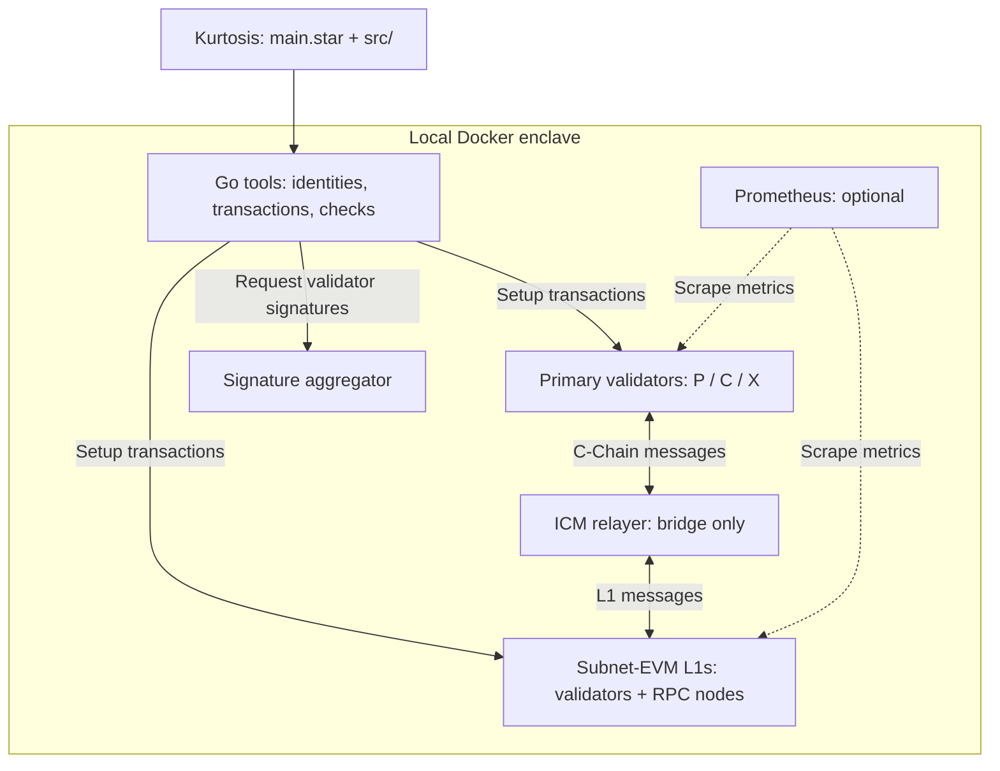

# kurtosis-avalanche

A Kurtosis package for testing Avalanche applications, validator management, and cross-chain transfers locally. One command creates the network and checks that it works.

## What it does

- Runs a primary network and one or more Subnet-EVM L1s with dedicated RPC nodes.
- Supports PoA, native-token staking, and ERC20-token staking.
- Optionally deploys and tests a collateralized C-Chain/L1 bridge and collects node metrics.

**Local development only.** Funded accounts have publicly known private keys. Never use them for real funds or production.

## Quick start

Install Docker and Kurtosis 1.18.2 or newer. From this directory:

```sh
kurtosis run --enclave avalanche-devnet . --args-file examples/default.yml
kurtosis enclave inspect avalanche-devnet
```

The default has three primary validators, four native-staked L1 validators, one L1 RPC node, a bridge, and Prometheus. Staking temporarily adds **20 bootstrap nodes per L1**, then removes them. Memory limits are 512 MB per bootstrap node and 1536 MB per permanent node. Allow several minutes for setup.

For a smaller PoA network without staking transitions, bridge, or metrics:

```sh
kurtosis run --enclave avalanche-small . --args-file examples/poa.yml
```

Use a **fresh enclave** each time. `bash scripts/run.sh [profile.yml]` generates a unique name; set `ENCLAVE` to choose one.

## Architecture



Kurtosis manages the services. Go tools generate identities, submit transactions, and verify setup. The signature aggregator supports validator management; the relayer delivers bridge messages.

Default node, ICM, and Prometheus images are pinned by digest. Only the Go tools build locally; no host Go, Foundry, or Avalanche checkout is needed. The first build downloads dependencies.

## Configure

Choose a profile with `--args-file`:

| Profile | Purpose |
| --- | --- |
| [default.yml](examples/default.yml) | Native staking, bridge, and metrics |
| [poa.yml](examples/poa.yml) | Small PoA network |
| [erc20-pos.yml](examples/erc20-pos.yml) | Stake validators with the local STAKE token |
| [two-l1s.yml](examples/two-l1s.yml) | Two native-staked L1s |
| [custom.yml](examples/custom.yml) | Annotated configuration options |

Customize node counts, resources, genesis, VM settings, or images. Node settings merge **defaults → global → role → named node**. Set `bridge: false` or `metrics: false` to skip those features. [Input validation](src/config/input.star) defines defaults and protects required network settings.

## Results and cleanup

`kurtosis enclave inspect` shows host-mapped RPC ports. Package output includes internal RPC URLs, chain IDs, and contract addresses. Default EVM chain IDs are `88888` for C-Chain and `77777` for the first L1.

RPC paths are `/ext/bc/C/rpc` for C-Chain and `/ext/bc/<blockchain-id>/rpc` for L1s.

```sh
kurtosis files download avalanche-devnet deployment-manifest ./artifacts/manifest
kurtosis files download avalanche-devnet deployment-state ./artifacts/state
kurtosis enclave rm -f avalanche-devnet
```

**Keep exported state private:** it contains identities, transaction journals, and receipts. If setup fails, inspect logs and the tools service's `/state` before cleanup. Stop/start preserves state; enclave removal destroys it. Do not rerun creation against existing state.

## Tooling and checks

| Path | Role |
| --- | --- |
| `main.star`, `src/` | Configuration and service orchestration |
| `tools/` | Go transaction adapter and verification |
| `static_files/` | Genesis and runtime contract artifacts |
| `contracts/` | Token sources and developer-only artifact build |
| `scripts/`, `tests/` | Launch helpers and validation |

```sh
python3 -m unittest discover -s tests -v
bash scripts/build.sh             # Build tools; test layers may be cached.
bash scripts/check-contracts.sh   # Compare artifacts with the pinned build.
bash scripts/check-package.sh     # Lint and plan all profiles; no nodes started.
```

CI also runs fresh Go race tests and vet. The integration workflow runs live devnets; dry runs only validate package plans.
