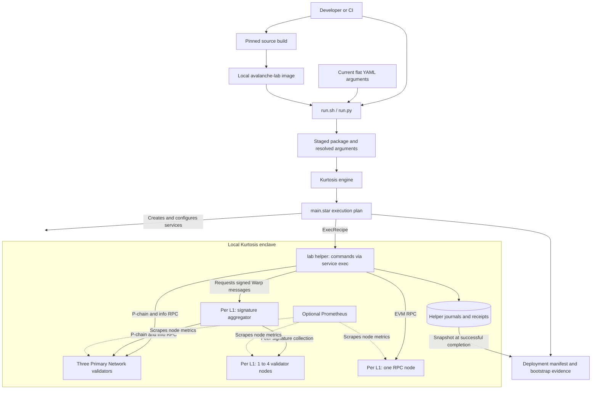
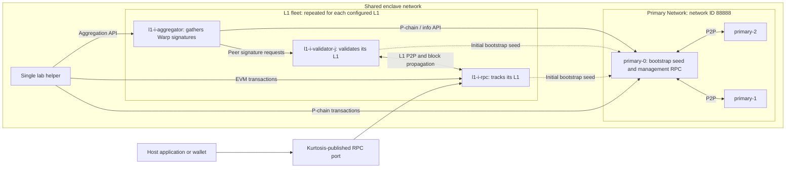
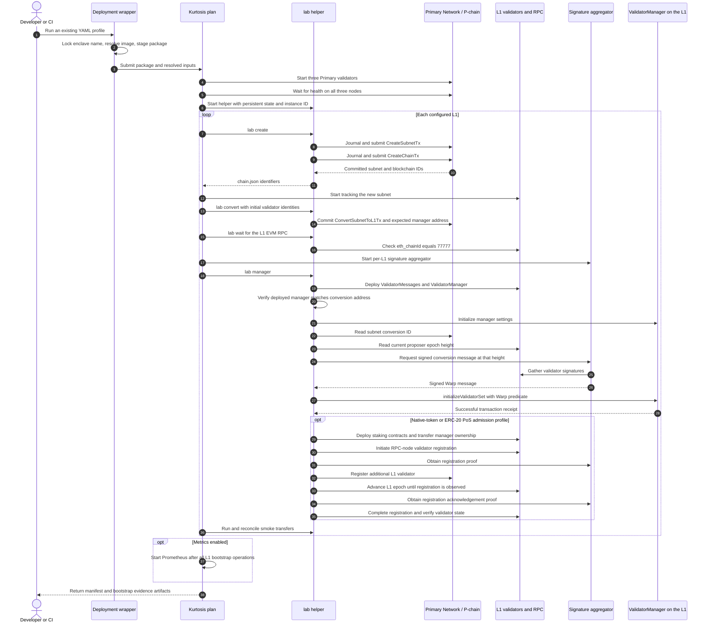
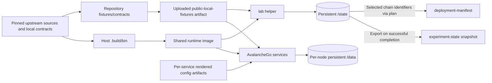
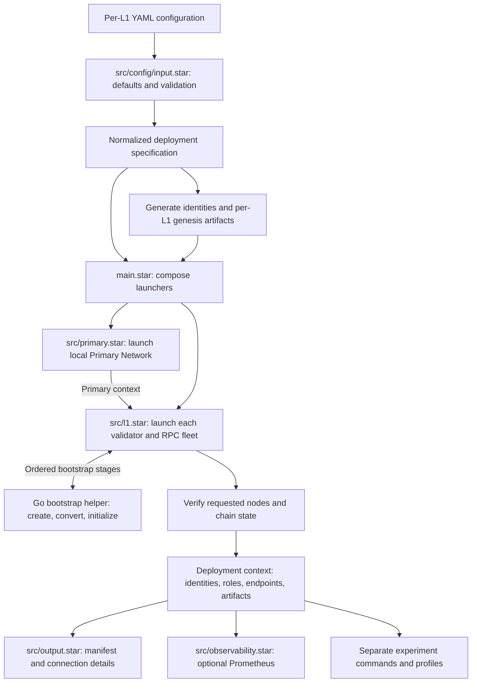

# Kurtosis Avalanche L1 package

A local Kurtosis package for Avalanche L1 experiments. Kurtosis owns each AvalancheGo node. A Go helper creates Subnets and blockchains, converts L1s, initializes validator managers using signed Warp proofs, and records recoverable transaction journals.

The goal is a standardized, configurable deployment package for local Avalanche L1s: define validator and RPC counts, fund development wallets, and reuse the same deployment foundation across use cases. The current implementation is an experiment laboratory with a working subset of the reviewed [plan](PLAN.md).

**Implementation status:** the current architecture below describes the code that runs today. The proposed architecture describes a smaller, configurable deployment foundation; its new modules and input schema are design only. This documentation does not implement them. Capability verification below refers to previously recorded local experiments.

- [Build and run](#build-and-run)
- [Current configuration](#current-configuration)
- [Current system design](#current-system-design)
- [Proposed deployment architecture](#proposed-deployment-architecture)
- [Inspect and collect evidence](#inspect-and-collect-evidence)
- [Load and recovery experiments](#load-and-recovery-experiments)
- [Institutional fixtures](#institutional-fixtures)
- [Validation and remaining work](#validation-and-remaining-work)

| Capability | Current status |
|---|---|
| Local Primary Network and Subnet-EVM L1 | End-to-end verified |
| One or two L1s with distinct validator identities | End-to-end verified; same Docker host |
| PoA validator-manager initialization | Real conversion proof verified on-chain |
| Native-token PoS admission | End-to-end verified, manager on its own L1 |
| ERC-20 PoS admission | End-to-end verified, manager on its own L1 |
| Complete transition to a fully PoS validator set | **Not implemented**; initial PoA validators remain |
| C-chain validator-manager placement | **Not implemented** |
| Cash, atomic DvP, oracle and escrow/accounting contracts | Solidity unit and fuzz tests; deployment integration pending |
| Open-loop native transfers | Verified accounting; latency values are polling upper bounds |
| Process pause/stop and whole-node network disconnection | Scoped fault runner; pause and controller-failure recovery verified |
| Temporary Primary Network unavailability | Three transfers accepted during a 15-second Primary-validator pause |
| Captured/frozen P-chain views, snapshot restore and long isolation | **Not implemented or certified** |
| Metrics | Prometheus service with five-second node scrapes |
| Live cross-L1 application relay and ICM recovery suite | **Not implemented**; current relayer build output is a Go archive, not a runnable relayer |
| Custom VM adapter, netem, disk pressure, Grafana | **Not implemented** |
| Delegation, rewards, removal and fee-depletion suites | **Not implemented** |

Native and ERC-20 profiles prove permissionless staking admission. They preserve the four unstaked bootstrap validators and promote the RPC node into a fifth validator. Rewards are configured at zero. They do not demonstrate a fully PoS-secured network.

## Build and run

Use Linux Docker, Python 3.10+ with `tarfile.data_filter` support (Python 3.12+ recommended), Go 1.27.1, Foundry 1.8.3 and Kurtosis 1.18.2. The candidate host budget is 8 vCPU, 16 GiB RAM and 50 GiB free storage. This minimum has not been certified. Build dependencies require internet access unless cached.

```bash
python3 -m pip install -r requirements-dev.txt
make build
make test
ENCLAVE=avax-lab bash scripts/run.sh examples/default.yml
```

The source exporter uses `tarfile.extractall(filter="data")`; older Python patch releases without [extraction-filter support](https://docs.python.org/3.10/library/tarfile.html#tarfile.TarFile.extractall) cannot run it.

The build exports immutable Git revisions into `.build/`. It does not edit reference checkouts. It uses local source clones when available and otherwise clones upstream repositories. Override their locations with `AVALANCHEGO_SOURCE` and `ICM_SOURCE`. The build applies one explicit AvalancheGo ID-decoder patch. Version and license provenance is recorded in `versions.json`, `scripts/patch-avalanche.py` and `licenses/`.

`run.sh` creates a small package upload, resolves the image ID, assigns a content-derived local tag, and records a unique experiment instance ID. It avoids uploading compiler caches. Run separate experiments with distinct enclave names. Re-executing the full package into an existing populated enclave is not supported; command-level journal recovery is supported.

Choose another profile:

```bash
ENCLAVE=avax-native bash scripts/run.sh examples/native-pos.yml
ENCLAVE=avax-erc20 bash scripts/run.sh examples/erc20-pos.yml
ENCLAVE=avax-two bash scripts/run.sh examples/two-l1s.yml
```

## Current configuration

Inputs are flat YAML with schema version 1. Supported fields are `l1_count` (1–2), `validator_count` (1–4), `staking` (`poa`, `native-pos`, `erc20-pos`), `smoke_transactions`, `metrics`, `node_memory_mb`, `node_cpu_millicores`, and image/instance provenance. Other fields fail validation. The four-validator defaults have been tested; smaller topologies are experimental.

| Input | Default | Current behavior |
|---|---|---|
| `schema_version` | `1` | Only schema 1 is accepted. |
| `l1_count` | `1` | Integer from 1 to 2; identical configuration is applied to each L1. |
| `validator_count` | `4` | Integer from 1 to 4 per L1, before any PoS admission. |
| `staking` | `poa` | `poa`, `native-pos`, or `erc20-pos`; PoS profiles admit one additional validator. |
| `smoke_transactions` | `5` | Integer from 1 to 1000; smoke transfers always run during deployment. |
| `metrics` | `true` | Enables the optional Prometheus service. |
| `node_memory_mb` | `1536` | Maximum memory per AvalancheGo service; integer from 512 to 16384. |
| `node_cpu_millicores` | `1000` | Maximum CPU per AvalancheGo service; integer from 100 to 16000. |
| `image` | `avalanche-lab:local` | Shared node/helper/aggregator image; the wrapper resolves and retags the local image. |
| `image_id` | `unverified` | Recorded by the wrapper; the Starlark parser does not independently verify it. |
| `instance_id` | Wrapper-generated UUID | Required nonempty value other than `manual`; plain default arguments fail without wrapper injection. |

RPC count, prefunded addresses, per-L1 EVM chain IDs, network ID, manager placement, and per-role resource overrides are not supported inputs. Use the existing example files with the current runner. The proposed YAML later in this README is not accepted by this parser.

Every node uses public fixture identities committed in `fixtures/`. Both L1s currently use EVM chain ID 77777, but have distinct Avalanche blockchain IDs and validator fleets. This intentionally allows replay-domain experiments; use the Avalanche blockchain ID when selecting an RPC or journal. Avoid reusing signed application transactions across L1s unless testing replay explicitly.

## Current system design

### Responsibilities and execution boundaries

The supported execution environment is a local Linux Docker host. A Kurtosis enclave groups services, their network, persistent directories, and file artifacts. AvalancheGo processes are individually owned by Kurtosis. The helper is a long-lived container running `sleep infinity`; Kurtosis executes short-lived `lab` commands inside it. It is not a background reconciliation controller.

| Component | Source | Responsibility |
|---|---|---|
| Source build | [scripts/build.sh](scripts/build.sh), [versions.json](versions.json) | Export pinned sources, apply the explicit AvalancheGo patch, compile binaries/contracts, and build one local image. |
| Deployment wrapper | [scripts/run.py](scripts/run.py) | Refuse an existing enclave, lock the deployment name, resolve the image, assign an instance UUID, and stage a small package upload. |
| Input parser | [src/config/input.star](src/config/input.star) | Apply defaults and reject unknown fields, invalid bounds, and unsupported staking profiles. |
| Orchestration | [main.star](main.star) | Render configuration, add services, order bootstrap commands, and export artifacts. |
| Avalanche lifecycle helper | [cmd/lab/lifecycle.go](cmd/lab/lifecycle.go), [cmd/lab/manager.go](cmd/lab/manager.go) | Submit P-chain transactions, convert Subnets to L1s, deploy contracts, and initialize the validator manager. |
| EVM transaction helper | [cmd/lab/evm.go](cmd/lab/evm.go) | Load contract artifacts, link libraries, sign transactions, journal them, and check receipts. |
| Staking experiment | [cmd/lab/staking.go](cmd/lab/staking.go) | Transfer manager ownership to a staking manager and admit the RPC node as an additional validator. |
| Observability | [main.star](main.star) | Optionally launch Prometheus with manually assembled AvalancheGo targets. |
| Experiments | [cmd/lab/benchmark.go](cmd/lab/benchmark.go), [scripts/experiment.py](scripts/experiment.py) | Generate native-transfer load, compare accepted state, and inject bounded Docker faults. |



Arrows show orchestration calls and selected runtime dependencies. P2P topology is expanded below. The same local image contains AvalancheGo, the Subnet-EVM plugin, the helper, and the signature aggregator; services select their executable through entrypoint overrides. It also copies a file named `icm-relayer`, but the current build targets the non-main `relayer` package and produces a Go archive. That file is not an executable relayer, and no relay service is launched.

### Network topology and chain identities

The default PoA deployment has eleven services: three Primary validators, four L1 validators, one L1 RPC node, one signature aggregator, the `lab` helper, and Prometheus. A second L1 adds its own validator fleet, RPC, and aggregator while sharing the Primary Network and helper.



P2P edges are illustrative; AvalancheGo discovers peers after initial bootstrap, and the diagram does not prescribe a full mesh or an isolated overlay network per L1. L1 nodes also maintain the Primary Network state needed for their operation. The aggregator is a separate peer client, not an Avalanche validator. L1 fleets have distinct node identities, but every service is on the same Docker host and enclave network.

| Identifier | Meaning | Current value or source |
|---|---|---|
| Avalanche network ID | Identifies the local Avalanche network, including Warp message domain | Fixed at `88888`. |
| Subnet ID | Identifies the validator-management domain | Returned by the P-chain CreateSubnet transaction. |
| Avalanche blockchain ID | Identifies a blockchain and its `/ext/bc/<id>/rpc` route | Returned by the P-chain CreateChain transaction; distinct between L1s. |
| EVM chain ID | Ethereum transaction-signing replay domain | Fixed at `77777` in the shared L1 genesis. |
| Node ID and BLS identity | Identify a node and its validator-signing material | Public development fixtures in `fixtures/node-*.json` and `fixtures/network.json`. |
| Deployment instance ID | Separates helper journal fingerprints across runs | UUID injected by the wrapper into `LAB_INSTANCE`. |

Avalanche blockchain IDs do not replace EVM chain IDs for transaction replay protection. The two-L1 profile deliberately shares an EVM chain ID; a standardized deployment should assign distinct EVM chain IDs by default.

Node fixture slots are fixed: Primary nodes use slots 0 through 2; the first L1 uses validator slots 3 through 6 and RPC slot 7; the second uses validator slots 8 through 11 and RPC slot 12. Smaller validator counts leave slots unused. The package applies the same consensus settings to all AvalancheGo nodes: sample size 3, preference quorum 2, and confidence quorum 2. These are local experiment settings; smaller validator fleets and fault tolerance require explicit validation.

### Bootstrap and validator-manager initialization

Bootstrap is sequential per L1. The helper uses the public EWOQ development account for P-chain ownership/funding, EVM deployment, and transfer workloads. Nodes use committed public staking keys and certificates. The local network ID guard rejects endpoints reporting a different network ID; it is not endpoint authentication.



The conversion commits manager address `0x17aB05351fC94a1a67Bf3f56DdbB941aE6c63E25` before the contract is deployed. This address assumes the fixture deployer and deployment nonce order. Inserting an earlier EVM transaction or changing the deployer can break initialization after conversion. Making this dependency explicit and validating it before conversion is a priority for the proposed design.

Native and ERC-20 admission add one validator without retiring the initial conversion validators. With the default four validators, the result is five validators, including the service still named `l1-0-rpc`. Prometheus retains its configured `rpc` role label for that service. Selecting `staking` therefore changes both on-chain ownership and the effective node role; it does not create a fully PoS validator fleet.

### Filesystem, artifacts, and provenance

| Location | Owner and lifecycle | Contents and limits |
|---|---|---|
| Repository `fixtures/` | Source inputs; contract export rewrites `fixtures/contracts/` during builds | Shared Primary/L1 genesis, all 13 node identities, BLS proofs, and ABI/bytecode artifacts. Uploaded together and mounted on nodes and the helper. |
| Repository `.build/` | Host build and staging workflow; ignored by Git | Pinned source exports, Go workspace, binaries, and per-instance staged package copies. |
| Repository `artifacts/` | Host build/run/experiment workflow; ignored by Git | Build logs, binary hashes, resolved run arguments, enclave names, and fault leases. Enclave artifacts require explicit download. |
| Node `/config` | Kurtosis-rendered file artifact | `node.json` and `chains/<blockchain-id>/config.json`; Warp API enabled for the configured chain. |
| Node `/data` | Kurtosis Directory with `<service-name>-data` persistent key | AvalancheGo databases and mutable node state. Persistent keys support service reuse within the enclave; they are not portable backups. |
| Helper `/fixtures` | Uploaded shared fixture artifact | Genesis, node metadata, and contract ABIs/bytecode used by helper commands. |
| Helper `/state` | Kurtosis Directory with `lab-state` persistent key | Per-L1 journals, receipts, conversion proofs, manager/migration metadata, and later experiment outputs. |
| Aggregator `/config` | Kurtosis-rendered file artifact | P-chain/info endpoints, tracked subnet, API port, metrics port, and local-network settings. |
| `deployment-manifest` | Kurtosis file artifact rendered after successful bootstrap | `deployment.json` with resolved configuration, network ID, per-L1 subnet/blockchain IDs, internal RPC URLs, profile flags, and version metadata. |
| `experiment-state` | Kurtosis snapshot of helper `/state` after successful bootstrap | Bootstrap evidence as of export time; later helper changes do not update this artifact. |



The wrapper records the image ID and creates a content-derived local tag. `versions.json` records intended source/tool versions. Contract hashes are recorded in `fixtures/contracts/hashes.json`, and the helper records the submitted genesis hash in `chain.json`. The manifest also hardcodes `support_level` to `experimental-poa`, including for staking-admission profiles. These records are not yet a unified, runtime-verified provenance bundle: the helper does not verify contract artifact hashes on load, and the final manifest omits genesis/contract hashes, EVM chain IDs, manager addresses, and node inventories.

### Transaction state, retries, and failure behavior

P-chain and contract EVM operations use journals. A helper-wide file lock serializes commands inside the one helper container because they share the funded account. All helper commands currently acquire this lock, including read-only commands. The lock does not coordinate separate containers or host processes.

```mermaid
stateDiagram-v2
    [*] --> Prepared: Sign and persist exact transaction bytes
    Prepared --> Submitted: Broadcast succeeds and journal is saved
    Prepared --> Reconcile: Restart or uncertain broadcast
    Submitted --> Reconcile: Restart or poll chain state
    Reconcile --> Submitted: P-chain status Unknown; reissue same bytes
    Reconcile --> Reconcile: Pending or temporarily unavailable
    Submitted --> Accepted: Committed transaction or successful EVM receipt
    Reconcile --> Accepted: Chain confirms prior acceptance
    Prepared --> Failed: Observed abort or revert
    Submitted --> Failed: Observed abort or revert
    Reconcile --> Failed: Observed abort or revert
    Accepted --> [*]
    Failed --> [*]
```



This diagram describes operation handling, not a shared enum implemented identically by both journal types. P-chain journals record `prepared`, `submitted`, and `accepted`; an observed abort returns an error. EVM journals additionally record `reverted`. An unresolved EVM transaction may be rebroadcast with the same signed bytes before polling. Fingerprints include deployment identity and operation inputs; mismatches and invalid transaction hashes/versions stop recovery. JSON journals use temporary files, file sync, rename, and directory sync.

A failed command preserves its journals in helper state, allowing a compatible command to reconcile and resume. The deployment wrapper refuses a populated enclave, so full-package reruns are not a recovery mechanism. Smoke transfers and benchmark attempts do not use the same durable transaction-journal recovery protocol. A timeout remains an unresolved outcome until checked against chain state.

Current readiness checks cover Primary health, node listening ports, the expected L1 EVM chain ID, successful manager initialization transactions, and reconciled smoke transfers through the chosen RPC node. They do not explicitly verify health, validator membership, and accepted-state agreement for every requested L1 node. Failure before final export can leave useful live helper files and service logs without a final manifest/evidence artifact; collect those explicitly before removing the enclave.

### Observability and operational boundaries

AvalancheGo exposes HTTP JSON-RPC/health/metrics on port `9650` and staking/P2P on `9651`. The aggregator declares HTTP API port `8080`; its configured metrics port `8081` is currently neither declared in Kurtosis nor scraped. Prometheus exposes port `9090`, scrapes node `/ext/metrics` every five seconds, and labels targets with `node` and configured `role`. It has 30-minute retention and no persistent data mount. Grafana, alerts, relayer metrics, and automatic failure exports are not implemented.

Internal clients use IP-based URLs returned by the plan because AvalancheGo's default HTTP host checks can reject service aliases. Host clients discover mapped endpoints through `kurtosis service inspect`; the manifest currently contains internal addresses only. Monitoring starts after bootstrap and therefore cannot diagnose earlier bootstrap stages through historical scrapes.

The local fixtures contain public private keys and certificates intended for disposable development. Network ID checks and deployment fingerprints prevent some accidental misuse and journal mix-ups; they provide no authentication, secret isolation, or production key management. The current single-host package does not establish multi-host fault independence, production RPC isolation, or high availability. Temporary L1 transfer success during a Primary outage does not prove support for indefinite disconnection or frozen P-chain views.

## Proposed deployment architecture

**Design only:** the architecture, module names, output contract, and YAML in this section are not implemented. The first delivery should be a small, reproducible local PoA deployment with configurable L1 fleets. Existing experiments can remain available outside the default path. The broader [PLAN.md](PLAN.md) describes a longer-term laboratory roadmap and is not the acceptance checklist for this smaller foundation.

### Scope and design rules

1. Starlark owns service topology and lifecycle ordering; a focused Go helper owns Avalanche-specific transactions and reconciliation.
2. Normalize and validate inputs before creating services. Use one resolved configuration for genesis, node flags, consensus settings, readiness expectations, and outputs.
3. Preserve a simple local Primary Network default. Describe each L1 independently, with explicit validator and nonvalidating RPC counts and distinct EVM chain IDs by default.
4. Generate the required node identities and per-L1 genesis artifacts. Retain a fixed fixture profile for reproducible tests. Prefunding accepts addresses and balances without requiring user private keys.
5. Keep configured roles stable. Staking admission and migration are explicit lifecycle experiments rather than implicit changes to the RPC fleet.
6. Keep node data and helper journals persistent within the enclave; treat exported artifacts as immutable snapshots with documented capture times.
7. Use pinned, compatible runtime images for ordinary deployment and retain source builds as a developer path. Preserve the current AvalancheGo patch until an equivalent unpatched combination is verified.
8. Add optional services through small launchers consuming service contexts. Build advanced lifecycle features when a concrete use case needs them.

### Proposed components and dependency flow



`src/l1.star` would own the create-chain, launch-nodes, convert-L1, initialize-manager, and readiness sequence. That sequence requires runtime-produced IDs; it should not be treated as a single static template expansion. The bootstrap helper may remain an idle Kurtosis service with commands executed inside it, preserving one account writer and durable journals without introducing a controller.

A small repository layout is sufficient:

```text
main.star                  # Composition and returned deployment context
src/config/input.star      # Defaults, normalization, validation
src/primary.star           # Primary Network launcher and context
src/l1.star                # Per-L1 topology and ordered bootstrap
src/observability.star     # Optional node metrics
src/output.star            # Manifest and connection information
cmd/bootstrap/             # Focused Avalanche transaction helper
static_files/              # Source templates and explicit test fixtures
examples/                  # Small supported deployment configurations
experiments/               # Staking, workloads, faults, application fixtures
```

These are proposed responsibilities, not a requirement to create every directory immediately. Useful reference patterns are launcher/context separation and distinct config/data/key mounts in `~/kurtosis-pos`, plus optional service launchers and metrics discovery in `~/kurtosis-cdk`. These repositories are design references, not runtime dependencies. Avoid copying their full option and deployment-stage machinery.

### Proposed configuration contract

This example is **not runnable with the current parser**. All balance values below are decimal strings in wei. `rpc_nodes` counts dedicated nonvalidating nodes; validators still expose RPC endpoints for diagnostics. A zero-RPC topology may be supported by selecting a validator endpoint for bootstrap and clearly reporting that choice.

```yaml
schema_version: 2
l1s:
  - name: payments
    chain_id: 77777
    validators: 4
    rpc_nodes: 2
    prefunded_accounts:
      "0x1111111111111111111111111111111111111111": "1000000000000000000000"
      "0x2222222222222222222222222222222222222222": "500000000000000000000"
  - name: settlement
    chain_id: 77778
    validators: 2
    rpc_nodes: 1
    prefunded_accounts:
      "0x1111111111111111111111111111111111111111": "250000000000000000000"
additional_services:
  - prometheus
```

Keep the first schema small. Validate unique names and chain IDs, positive validator counts, nonnegative RPC counts, address syntax, nonnegative integer balances, and supported consensus/validator-count combinations. Reject unknown fields and unsupported combinations before launch. Default development funding must also cover the bootstrap account's deployment costs; user prefunding must not silently remove required bootstrap funding. Merge duplicate account allocations deterministically and reject conflicting reserved contract/precompile entries if custom genesis support is later added.

Expose fee settings, image overrides, resources, or extra node/chain flags only with documented precedence and validation. Generated identity, genesis paths, subnet tracking, plugin compatibility, and required management settings must remain internally consistent. Network ID `88888` can remain the initial local-only default; remote Primary Network attachment and production keys are separate future work.

### Proposed service and output contracts

Each node context should contain its service name, configured and observed role, node ID, subnet/blockchain membership, internal HTTP/WS endpoint where enabled, metrics URL/path, and genesis/config artifact references. Each L1 context should contain its EVM chain ID, subnet ID, blockchain ID, manager address, validator nodes, RPC nodes, and the endpoint chosen for bootstrap. Module consumers should use these contexts rather than hardcoded names, ports, or fixture indexes.

The deployment manifest should include a schema version, deployment instance, resolved inputs, actual image/version references, genesis/config/contract hashes, per-chain identifiers, manager addresses, node membership, service names, and declared capabilities. Include host endpoints when the runtime can resolve them; otherwise provide an explicit discovery command and keep internal endpoints separately identified. Exclude private keys. This manifest becomes the input for optional observability, application deployment, and experiment commands.

Before marking a deployment ready, verify the expected chain identity on the selected endpoints, requested validator membership and weight, healthy/bootstrapped participating nodes, manager initialization, and one accepted transaction observed through the intended client endpoint. Stronger recovery checks can compare accepted hashes at a common height. Collect failure diagnostics from started services and helper state without requiring successful final bootstrap.

The manager-address issue must be resolved before making the bootstrap deployer or transaction order configurable. The smallest first step is to derive the expected CREATE address from the selected account and required nonce sequence, verify the account state before conversion, and serialize the deployments. Any later CREATE2 or genesis-predeployment alternative needs its own compatibility proof.

### Delivery order and deferred capabilities

| Stage | Deliverable and acceptance evidence |
|---|---|
| 1. Establish the existing baseline | Preserve a working four-validator PoA profile and record its bootstrap receipts, configuration, and image identity. |
| 2. Extract boundaries | Move existing orchestration into a few launchers/contexts while preserving the baseline's chain and manager behavior. |
| 3. Make deployments configurable | Generate topology and per-L1 genesis; verify multiple validator/RPC counts, explicit prefunding balances, unique chain IDs, and early rejection of invalid configurations. |
| 4. Standardize consumption | Make pinned images and normal package execution usable; export complete manifests and optional metrics from the same contexts. |
| 5. Keep extensions separate | Run staking-admission, chaos, performance, and application examples through explicit commands using the deployment context. |

The initial package does not need a generic VM adapter framework, a production key-management service, a cloud deployment backend, a controller, an explorer, or a full snapshot system. Grafana, PoS validator retirement, delegation/rewards, external-network attachment, captured P-chain views, live cross-L1 messaging, ICTT, and institutional application deployment remain separate additions.

The [Avalanche Builder Console](https://build.avax.network/console) provides a longer-term capability map: L1 creation, validator operations, tokenomics, monitoring, and interchain tooling. The package should expose reusable configuration and lifecycle commands for the capabilities it supports. Full Console parity is not claimed by the current implementation or required for the first standardized local deployment.

## Inspect and collect evidence

```bash
kurtosis enclave inspect avax-lab
kurtosis files download avax-lab deployment-manifest artifacts/deployment
kurtosis files download avax-lab experiment-state artifacts/bootstrap-evidence
kurtosis service inspect avax-lab l1-0-rpc
kurtosis service inspect avax-lab prometheus
```

The current manifest contains enclave-internal RPC URLs, subnet IDs, Avalanche blockchain IDs, resolved inputs and pinned-version metadata. EVM chain IDs and manager addresses are not yet exported in the manifest. Use the host RPC port printed by `service inspect` for host clients. Use internal URLs for commands in the `lab` helper. Avalanche's default RPC host checks require the IP URLs from the manifest; Docker service aliases can receive HTTP 403.

`experiment-state` is a snapshot of bootstrap evidence at package completion. Later experiments write into the helper's `/state`; retrieve those files explicitly. Do not mistake the bootstrap artifact for a live export.

The helper serializes its commands because they share one funded fixture account. Run all writers through the single `lab` service for that enclave. Separate host processes or helper containers do not share that lock and must not write concurrently to the same account. P-chain and EVM journals store signed bytes before submission. Recovered operations reissue the same bytes, validate hashes, and query chain state. A journal input mismatch stops execution.

## Load and recovery experiments

Substitute the actual internal RPC URL from the deployment manifest:

```bash
kurtosis service exec avax-lab lab 'lab load RPC_URL 20 5 /state/load-001'
kurtosis service exec avax-lab lab 'cat /state/load-001/result.json'
kurtosis service exec avax-lab lab 'lab compare VALIDATOR_RPC_URL RPC_NODE_URL'
```

`load` offers native transfers on a fixed schedule with a bounded queue and 16 submission workers. It distinguishes unsubmitted operations, pending/unknown attempts, accepted successes and reverts. It drains for up to 30 seconds and reconciles the recipient balance. It retains submission errors without classifying transport failures as definite rejection. Retries are not implemented in this workload. Only one run may write to the tested recipient at a time.

Receipt polling begins after submission finishes. Reported latency quantiles are upper bounds, not accurate acceptance-latency measurements. The result is informational and does not claim a business SLO or maximum chain capacity. Seeds, application transaction mixes, ramps and generator-capacity calibration remain roadmap work.

Use explicit enclave-scoped faults:

```bash
python3 scripts/experiment.py inject --enclave avax-lab \
  --service l1-0-validator-0 --fault pause --seconds 5
python3 scripts/experiment.py inject --enclave avax-lab \
  --service primary-0 --service primary-1 --service primary-2 \
  --fault pause --seconds 15
```

Available faults are `pause`, `stop` and `disconnect`. A separate watchdog owns expiry cleanup. Durable leases record original container identities and network memberships. A failed cleanup leaves an explicit failed lease for inspection:

```bash
python3 scripts/experiment.py recover artifacts/faults/LEASE.json
```

Network disconnection affects the entire selected node, including RPC. A Primary-validator pause is a temporary availability experiment. It does not establish a frozen P-chain view, supported air-gapped operation, or behavior after validator fee exhaustion. Run `lab compare` and application assertions after recovery. Single-host site labels are simulations.

## Institutional fixtures

`contracts/src/Institutional.sol` contains a permissioned ledger, bilateral-authorized atomic DvP, a controlled price feed and freshness-gated settlement. Tests cover conservation, duplicate operations, authorization, revocation and rollback of both settlement legs.

`CrossChainSettlement.sol` demonstrates authenticated escrow decisions and destination accounting credits. It is not a spendable bridge. A timeout requests an abort; only an authenticated terminal abort permits a refund. Revoked payers retain a refund liability and claim after reinstatement. Tests mock Warp and cover duplicate delivery, late opens, conflicting decisions and controller authorization. Live relayer integration remains unverified.

`StakingToken.sol` is a synthetic mintable staking asset with an explicit reward minter. It has no institutional backing or redemption promise.

## Validation and remaining work

`make test` runs Go tests with the race detector, Solidity tests including fuzzing, and configuration/fault-runner tests. Scheduled integration profiles require a trusted `avalanche-lab` runner. Pull-request checks use hosted runners and do not run arbitrary contributions on the trusted integration host.

The reviewed plan records the remaining release gates. No snapshot, custom-VM, fully-PoS, cross-chain application or institutional performance certification should be inferred from successful basic deployment.

Clean up an experiment when finished:

```bash
kurtosis enclave rm -f avax-lab
```
